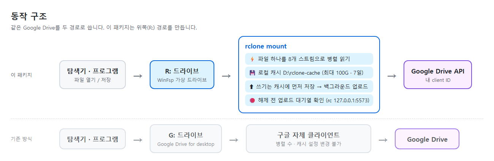
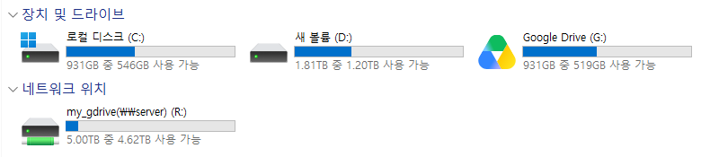
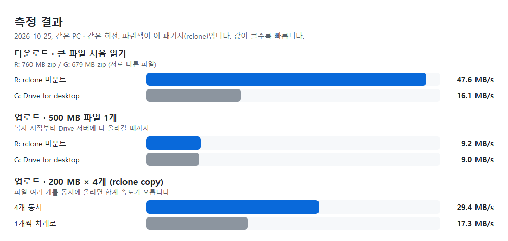
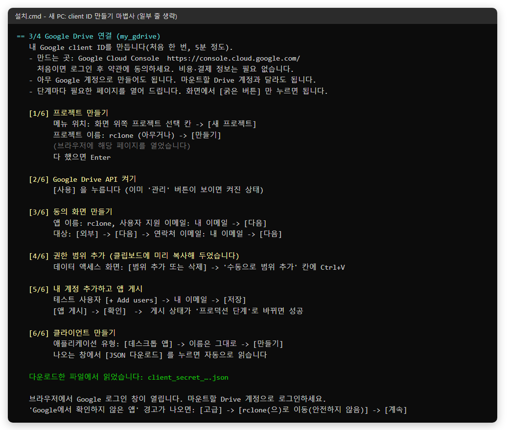
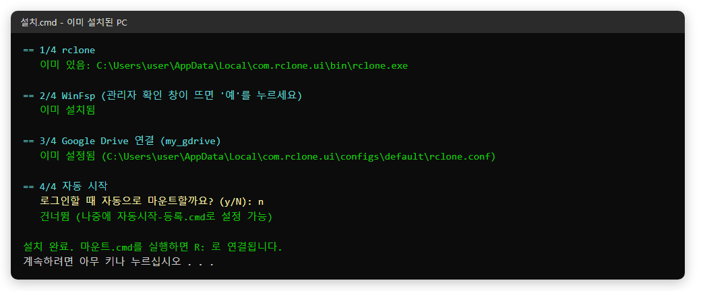
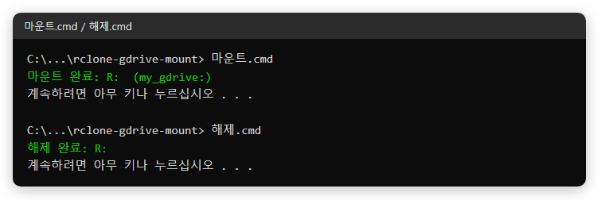

# Google-drive-accelerator

Google Drive를 **rclone**으로 Windows 드라이브 문자(기본 `R:`)에 마운트하는 스크립트 모음입니다.
Google Drive for desktop(G:)과 같은 Drive를 쓰면서도 **큰 파일을 처음 읽을 때 약 3배 빠르게** 읽을 수 있도록, 병렬 읽기와 로컬 캐시를 켜 둔 구성입니다.



- 탐색기, 압축 프로그램, Python 등 어떤 프로그램에서든 `R:\...` 경로로 Drive 파일을 바로 엽니다.
- 처음 한 번 `설치.cmd`만 실행하면 필요한 프로그램 설치와 Google 로그인까지 안내합니다.
- 기존 Google Drive for desktop(G:)은 그대로 두고 함께 쓸 수 있습니다.

---

## 목차
1. [빠른 시작](#빠른-시작)
2. [측정 결과](#측정-결과)
3. [설치 자세히](#설치-자세히)
4. [Google client ID 만들기](#google-client-id-만들기)
5. [사용법](#사용법)
6. [설정 바꾸기](#설정-바꾸기)
7. [동작 방식](#동작-방식)
8. [WSL에서 쓰기](#wsl에서-쓰기)
9. [문제 해결](#문제-해결)
10. [제거](#제거)
11. [파일 구성](#파일-구성)

---

## 빠른 시작

1. 이 레포를 내려받습니다(초록색 **Code → Download ZIP** 후 압축 풀기, 또는 `git clone`).
2. **`설치.cmd`** 를 더블클릭합니다. rclone과 WinFsp가 설치되고 Google Drive 연결을 안내합니다.
3. **`마운트.cmd`** 를 더블클릭합니다. 탐색기 "내 PC"에 `R:` 드라이브가 생깁니다.



*실제 화면입니다. `R:`은 "네트워크 위치"에 `my_gdrive(\\server) (R:)`로 나타나고, 용량은 Drive 저장 공간 기준으로 표시됩니다. 위의 `Google Drive (G:)`는 기존 Drive for desktop입니다.*

---

## 측정 결과



2026-10-25, 같은 PC와 같은 회선에서 직접 잰 값입니다.

| 항목 | rclone (이 패키지) | 비교 대상 | 결과 |
|---|---|---|---|
| 다운로드: 큰 파일 처음 읽기 | R: 760 MB, **47.6 MB/s** | G: 679 MB, 16.1 MB/s | 약 3배 빠름 |
| 업로드: 500 MB 파일 1개 | R: 54.2초, 9.2 MB/s | G: 55.8초, 9.0 MB/s | 차이 없음 |
| 업로드: 200 MB × 4개 (rclone copy) | 4개 동시 **29.4 MB/s** | 1개씩 17.3 MB/s | 약 1.7배 |

알아 둘 점:
- **다운로드가 빠른 이유**는 파일 하나를 8개 스트림으로 나눠 동시에 받기 때문입니다.
- **작은 파일(약 100 MB 이하)은 차이가 작거나 오히려 느릴 수 있습니다.** 처음 연결에 2~4초가 걸리기 때문입니다. 실제로 100 MB zip은 R: 8.4 MB/s, G: 29 MB/s였습니다.
- **업로드는 파일 하나 기준으로 빨라지지 않습니다.** Google Drive 업로드는 조각을 순서대로만 받아서 한 파일을 쪼개 동시에 올릴 수 없습니다. 대신 여러 파일을 한꺼번에 복사하면 동시에 올라갑니다(마운트 기본 동시 4개).
- 다운로드 비교에 쓴 두 파일은 서로 다른 파일이라 대략적인 비교입니다.
- 한 번 읽은 파일은 로컬 캐시에서 열려 디스크 속도로 읽힙니다.

직접 재 보려면:
```powershell
.\Test-Speed.ps1 "R:\경로\큰파일.zip" "G:\내 드라이브\경로\다른큰파일.zip"
```
같은 파일을 두 번 재면 두 번째는 캐시에서 읽으므로, 비교할 때는 서로 다른 파일이나 처음 여는 파일을 쓰세요.

---

## 설치 자세히

`설치.cmd`는 아래 4단계를 차례로 처리합니다. **이미 된 단계는 건너뛰므로 여러 번 실행해도 안전합니다.**

| 단계 | 하는 일 | 필요할 때 |
|---|---|---|
| 1. rclone | 없으면 `winget install Rclone.Rclone` | Rclone UI 내장본이나 PATH의 rclone이 있으면 그대로 사용 |
| 2. WinFsp | 없으면 `winget install WinFsp.WinFsp` | 관리자 확인(UAC) 창에서 **예** |
| 3. Google Drive 연결 | remote(`my_gdrive:`)가 없으면 client ID 만들기 마법사 → Google 로그인 | 처음 한 번 |
| 4. 자동 시작 | 로그인할 때 자동 마운트할지 질문 | 선택 |

**새 PC에서 실행한 화면** (3단계 client ID 만들기 마법사, 아래 [Google client ID 만들기](#google-client-id-만들기) 참고):



**이미 설치된 PC에서 실행한 화면** (모두 건너뜀):



*두 화면 모두 실제 실행 결과를 콘솔 모양으로 옮긴 것입니다.*

준비물:
- Windows 10/11
- winget(“앱 설치 관리자”, Windows 10/11 기본 포함). 없으면 Microsoft Store에서 설치합니다.
- Google 계정

---

## Google client ID 만들기

`설치.cmd`를 실행하면 3단계에서 **client ID 만들기 마법사**가 시작됩니다. 절차는 [rclone 공식 문서](https://rclone.org/drive/#making-your-own-client-id)를 따르되, 손이 덜 가도록 다음을 자동으로 해 줍니다.

- **페이지 자동 열기**: 단계마다 해당 Console 페이지를 브라우저로 바로 엽니다. 메뉴를 찾아다닐 필요가 없습니다.
- **범위 미리 복사**: 4단계에서 넣을 권한 범위 문자열을 클립보드에 미리 복사해 둡니다. 붙여 넣기(Ctrl+V)만 하면 됩니다.
- **ID 자동 읽기**: 마지막에 **JSON 다운로드**를 누르면 다운로드 폴더의 `client_secret_*.json`을 자동으로 읽습니다. ID와 비밀을 복사해 붙여 넣을 필요가 없습니다.

### 어디서 만드나요?
client ID는 **Google Cloud Console**에서 만듭니다.

1. 브라우저에서 **<https://console.cloud.google.com/>** 에 접속해 Google 계정으로 로그인합니다.
2. 처음 접속하면 국가 선택과 서비스 약관 동의 화면이 나옵니다. 동의하고 넘어가면 됩니다. client ID를 만드는 데는 비용이 들지 않고 결제 정보도 필요 없습니다.
3. 필요한 메뉴는 모두 왼쪽 위 **≡(메뉴)** 안에 있습니다. 화면 위쪽 검색창에 메뉴 이름을 입력해 찾아도 됩니다.
   - **API 및 서비스** → **라이브러리**: Drive API를 켜는 곳
   - **Google 인증 플랫폼**(영문 화면은 Google Auth Platform): 동의 화면(개요·브랜딩), **대상**, **데이터 액세스**, **클라이언트**가 모두 여기에 있습니다.

`설치.cmd` 마법사는 각 단계의 페이지를 자동으로 열어 주므로 보통은 메뉴를 찾을 필요가 없습니다. 페이지가 안 열리거나 다른 프로젝트가 선택돼 있으면 아래 표의 **메뉴 위치**를 따라 들어가세요.

> 💡 client ID는 **아무 Google 계정**으로 만들어도 됩니다. 마운트할 Drive 계정과 달라도 됩니다. 한 번 만들면 다른 PC에서도 그대로 씁니다.

| 단계 | 메뉴 위치 (≡ 메뉴 기준) | 바로 가기 | 할 일 |
|---|---|---|---|
| 1. 프로젝트 만들기 | 화면 위쪽 프로젝트 선택 칸 → **새 프로젝트** | [열기](https://console.cloud.google.com/projectcreate) | 이름 `rclone`(아무거나) → **만들기**. 만든 뒤 위쪽 칸에 그 프로젝트가 선택됐는지 확인 |
| 2. Drive API 켜기 | API 및 서비스 → 라이브러리 → "Google Drive API" 검색 | [열기](https://console.cloud.google.com/apis/library/drive.googleapis.com) | **사용** (이미 "관리"가 보이면 켜진 상태) |
| 3. 동의 화면 | Google 인증 플랫폼 → 개요 → **시작하기** | [열기](https://console.cloud.google.com/auth/overview/create) | 앱 이름 `rclone`, 지원 이메일 → 대상 **외부** → 연락처 이메일 → 약관 동의 → **만들기** |
| 4. 권한 범위 | Google 인증 플랫폼 → **데이터 액세스** | [열기](https://console.cloud.google.com/auth/scopes) | **범위 추가 또는 삭제** → 아래쪽 "수동으로 범위 추가" 칸에 **Ctrl+V** → **표에 추가** → **업데이트** → 맨 아래 **저장** |
| 5. 게시 | Google 인증 플랫폼 → **대상** | [열기](https://console.cloud.google.com/auth/audience) | 테스트 사용자 **+ Add users**에 내 이메일 → **저장**, 그다음 **앱 게시** → **확인** |
| 6. 클라이언트 | Google 인증 플랫폼 → **클라이언트** → **클라이언트 만들기** | [열기](https://console.cloud.google.com/auth/clients/create) | 유형 **데스크톱 앱** → **만들기** → **JSON 다운로드** |

4단계에서 클립보드에 복사되는 값은 rclone 문서가 권장하는 범위 세 개입니다.
```
https://www.googleapis.com/auth/docs,https://www.googleapis.com/auth/drive,https://www.googleapis.com/auth/drive.metadata.readonly
```

마법사가 끝나면 Google 로그인 창이 열립니다. **마운트할 Drive 계정**으로 로그인하세요.
- **"Google에서 확인하지 않은 앱" 경고가 나옵니다.** **고급 → rclone(으)로 이동(안전하지 않음) → 계속**을 누르면 됩니다. 내가 만든 앱이라 Google 검증을 받지 않았을 뿐이고, 사용자 100명 미만의 개인용 앱은 검증이 필요 없습니다.
- 로그인이 끝나면 스크립트가 Drive 접속을 실제로 확인한 뒤 "연결됨"을 표시합니다.

### 꼭 지켜야 할 것: 앱 게시
5단계에서 **앱 게시**를 하지 않고 "테스트" 상태로 두면 로그인이 **7일마다 만료**되어 마운트가 끊깁니다. 게시 상태가 **프로덕션 단계**로 바뀌었는지 꼭 확인하세요.

### 앱 게시 버튼이 회색일 때
Google이 게시 전에 홈페이지 주소와 개인정보처리방침 주소를 요구하는 경우입니다(rclone 문서에 안내된 상황).
1. [브랜딩](https://console.cloud.google.com/auth/branding) 화면에서 "애플리케이션 홈페이지"와 "개인정보처리방침 링크"를 채웁니다. 내 도메인이 없으면 무료 GitHub Pages 주소도 됩니다.
2. "승인된 도메인"에 그 주소의 도메인을 넣고 **저장**합니다.
3. [대상](https://console.cloud.google.com/auth/audience) 화면으로 돌아가면 **앱 게시**를 누를 수 있습니다.

### JSON 파일을 못 찾았다고 나올 때
다운로드 창을 닫았거나 다른 폴더에 저장한 경우입니다. 마법사가 직접 입력을 받습니다. [클라이언트 목록](https://console.cloud.google.com/auth/clients)에서 방금 만든 클라이언트를 열어 **클라이언트 ID**와 **클라이언트 보안 비밀**을 복사해 차례로 붙여 넣으세요.

### 왜 client ID를 직접 만들어야 하나요?
- **공용 ID는 곧 막힙니다.** rclone 기본 공용 client ID는 2026년 중 사용이 중단될 예정이라고 rclone 1.75가 직접 경고합니다. 그 전에도 여러 사람이 나눠 써서 느리거나 제한되기 쉽습니다.
- **자동 생성이 불가능합니다.** Google은 OAuth client를 프로그램으로 만드는 API를 제공하지 않습니다. 유일했던 IAP OAuth Admin API도 2026-03-19에 종료됐습니다([Google 문서](https://docs.cloud.google.com/iap/docs/programmatic-oauth-clients)). 그래서 이 단계만은 Console에서 직접 해야 합니다.
- **한 번 만든 ID는 다른 PC에서도 그대로 쓸 수 있습니다.**

---

## 사용법

| 파일 | 하는 일 |
|---|---|
| `설치.cmd` | 의존성 설치와 Google Drive 연결(처음 한 번) |
| `마운트.cmd` | `R:`로 마운트 |
| `해제.cmd` | 업로드 대기열이 빌 때까지 기다린 뒤 안전하게 해제 |
| `자동시작-등록.cmd` | 로그인할 때 자동 마운트(시작프로그램 바로가기, 관리자 권한 불필요) |
| `자동시작-해제.cmd` | 자동 시작 제거 |
| `Test-Speed.ps1` | 파일 읽기 속도 측정 |



- 마운트는 창 없이 백그라운드에서 돌아갑니다. 콘솔 창을 닫아도 `R:`은 유지됩니다.
- **해제는 꼭 `해제.cmd`로 하세요.** 업로드 중인 파일이 있으면 끝날 때까지 기다립니다. 정말 급하면 PowerShell에서 `.\Unmount-GDrive.ps1 -Force`를 실행합니다.
- PC를 재부팅하면 마운트가 풀립니다. 자동 시작을 등록해 두면 로그인할 때 다시 연결됩니다.

---

## 설정 바꾸기

`config.ps1`을 메모장으로 열어 값을 바꾼 뒤, 해제했다가 다시 마운트하면 적용됩니다.

| 변수 | 기본값 | 설명 |
|---|---|---|
| `$Remote` | `my_gdrive:` | 마운트할 remote. 하위 폴더만 걸려면 `my_gdrive:data` |
| `$DriveLetter` | `R:` | 드라이브 문자. `G:`는 Drive for desktop이 쓰므로 피하세요 |
| `$CacheDir` | `D:\rclone-cache\gdrive` | 로컬 캐시 위치. 용량 넉넉한 디스크 권장 (**D:가 없는 PC는 꼭 바꾸세요**) |
| `$CacheMaxSize` | `100G` | 캐시 최대 용량 |
| `$CacheMaxAge` | `168h` | 캐시 보관 기간(7일) |
| `$ChunkStreams` | `8` | 파일 하나를 동시에 읽는 스트림 수. 다운로드 속도 핵심 |
| `$ChunkSize` | `64M` | 스트림 하나가 한 번에 읽는 크기 |
| `$RcPort` | `5573` | 안전한 해제용 원격 제어 포트(로컬 전용) |
| `$RcloneExe` / `$RcloneConf` | 자동 탐색 | rclone 실행 파일과 설정 파일 위치 |

rclone 설정 파일은 다음 순서로 찾습니다. Rclone UI 설정(`%LOCALAPPDATA%\com.rclone.ui\configs\default\rclone.conf`)이 있으면 그것을 쓰고, 없으면 rclone 기본 위치(`%APPDATA%\rclone\rclone.conf`)를 씁니다. **인증 토큰은 이 설정 파일에만 저장되고 레포에는 들어가지 않습니다.**

---

## 동작 방식

`마운트.cmd`가 실행하는 핵심 옵션입니다.

| 옵션 | 의미 |
|---|---|
| `--vfs-read-chunk-streams 8` | 파일 하나를 8개 스트림으로 동시에 읽습니다(rclone 1.68 이상). |
| `--vfs-read-chunk-size 64M` | 스트림마다 64 MB씩 요청합니다. |
| `--vfs-cache-mode full` | 읽고 쓴 데이터를 로컬 캐시에 둡니다. 다시 열면 바로 열리고, 프로그램이 파일 중간을 읽거나 써도 안정적입니다. |
| `--vfs-cache-max-size`, `--vfs-cache-max-age` | 캐시 용량과 보관 기간 한도입니다. |
| `--dir-cache-time 1h`, `--poll-interval 1m` | 폴더 목록을 1시간 기억하고, Drive 쪽 변경은 1분마다 확인합니다. |
| `--network-mode` | 탐색기에 네트워크 드라이브로 표시합니다. |
| `--rc --rc-addr 127.0.0.1:5573` | `해제.cmd`가 업로드 대기열을 확인하고 정상 종료할 때 씁니다. |
| `--log-file` | 로그는 `D:\rclone-cache\gdrive\mount.log`에 남습니다. |

**쓰기 흐름**: `R:`에 파일을 저장하면 먼저 로컬 캐시에 쓰이고, 파일을 닫은 뒤 약 5초 뒤에 백그라운드에서 업로드가 시작됩니다. 그래서 탐색기 복사는 금방 끝나 보여도 실제 업로드는 계속 진행 중일 수 있습니다.

---

## WSL에서 쓰기

```bash
sudo mkdir -p /mnt/r
sudo mount -t drvfs R: /mnt/r
ls /mnt/r
```

---

## 문제 해결

| 증상 | 해결 |
|---|---|
| `rclone 또는 WinFsp가 없습니다` | `설치.cmd`를 먼저 실행하세요. |
| `30초 안에 마운트되지 않았습니다` | 출력된 로그 마지막 줄을 확인하세요(`mount.log`). 로그인 만료라면 아래 줄을 보세요. |
| 며칠 뒤 갑자기 접속이 안 됨 (`invalid_grant`, token expired) | 동의 화면이 테스트 상태입니다. Console에서 **앱 게시**로 프로덕션으로 바꾼 뒤 `rclone config reconnect my_gdrive:`를 실행하세요(Rclone UI 설정을 쓰면 `--config` 경로 지정). |
| `R: 는 이미 사용 중입니다` | 이미 마운트됐거나 다른 드라이브가 `R:`을 쓰고 있습니다. `config.ps1`에서 `$DriveLetter`를 바꾸세요. |
| `이 시스템에서 스크립트를 실행할 수 없으므로` | `.ps1`을 직접 실행하지 말고 `.cmd` 파일을 더블클릭하세요(실행 정책을 그 실행에서만 우회합니다). |
| 로그에 `symlinks not supported without the --links flag` | 마운트할 때마다 나오는 정상 메시지입니다. 무시하세요. |
| Google Docs/Sheets 파일이 docx/xlsx로 보임 | rclone은 Google 문서를 내보내기 형식으로 보여 줍니다. 정상입니다. |
| 캐시가 디스크를 너무 차지함 | `$CacheMaxSize`를 줄이거나, 해제한 뒤 `$CacheDir` 폴더를 지우세요. |

---

## 제거

1. `자동시작-해제.cmd` 실행
2. `해제.cmd` 실행
3. 캐시 폴더(`D:\rclone-cache\gdrive`) 삭제
4. 필요하면 프로그램 제거: `winget uninstall WinFsp.WinFsp`, `winget uninstall Rclone.Rclone`(이 패키지가 설치한 경우)
5. Google 연결을 끊으려면 [Google 계정 → 타사 앱 액세스](https://myaccount.google.com/connections)에서 앱 권한을 삭제합니다.

---

## 파일 구성

```
rclone-gdrive-mount/
├─ 설치.cmd / Install.ps1                 의존성 설치 + Google Drive 연결
├─ 마운트.cmd / Mount-GDrive.ps1           마운트
├─ 해제.cmd / Unmount-GDrive.ps1           안전한 해제
├─ 자동시작-등록.cmd / Install-Autostart.ps1
├─ 자동시작-해제.cmd / Uninstall-Autostart.ps1
├─ Test-Speed.ps1                         읽기 속도 측정
├─ config.ps1                             설정
└─ docs/images/                           README 이미지
```
